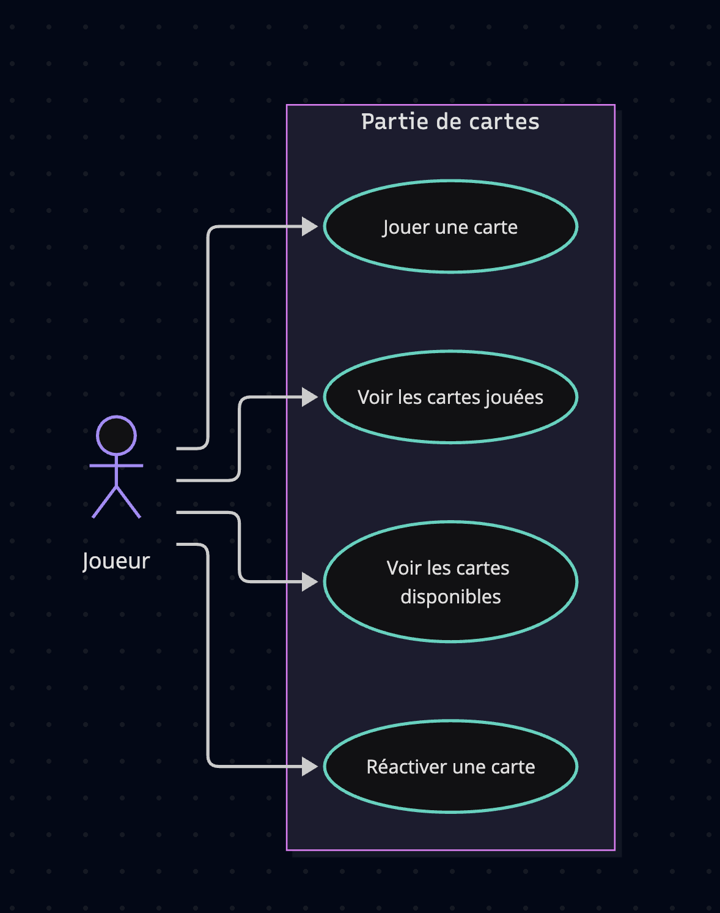

## TP 2 — Jouer des cartes

Durée indicative : 1 h 55, réparties sur les deux jours.
Ce TP reprend le principe du jeu de cartes de l'ancien cours.

Un joueur dispose d'une partie avec trois cartes identifiées : C1 vaut 3, C2 vaut 6
et C3 vaut 8. Au départ elles sont toutes disponibles. Il peut jouer une carte,
voir les cartes jouées, voir celles encore disponibles et réactiver une carte jouée.

Règles :

- **J1** : chaque carte de cette partie a un identifiant unique et une valeur.
- **J2** : jouer une carte disponible la fait passer à l'état joué.
- **J3** : rejouer une carte déjà jouée est refusé sans changer son état.
- **J4** : réactiver une carte jouée la rend disponible ; une carte déjà disponible
  reste disponible et la demande est signalée comme sans effet.

La partie reste en mémoire ; fermer l'application efface son état.
Pas de compte, de score, de multijoueur ni de sauvegarde.

### Travail demandé

1. Étapes A et B : choisir le cas « Jouer une carte » et rédiger nominal et refus.
2. Étape C : séquence détaillée pour jouer C2, puis tenter de la rejouer.
3. Étape D : classes, opérations et relation entre partie et cartes.
4. Expliquer pourquoi le besoin actuel ne demande pas de MCD de persistance.
5. Donner les listes attendues après : jouer C2, rejouer C2, réactiver C2.

Question de conception : qui connaît l'ensemble des cartes ? Qui connaît l'état
d'une carte ? Une seule classe qui fait tout est-elle encore lisible ?

Extension facultative : on veut retrouver ses parties le lendemain. Proposer
le changement minimal des données à conserver et ses cardinalités.

Livrable : `TP-02-cartes.md`, avec scénario, diagrammes et résultats attendus.


## Réalisation


### Etape A — Cas d'utilisation « Jouer une carte »
```mermaid
usecase-beta
direction LR
actor player("Joueur")
systemBoundary "Rules"
  J1("chaque carte de cette partie a un identifiant unique et une valeur.")
  J2("jouer une carte disponible la fait passer à l'état joué.")
  J3("rejouer une carte déjà jouée est refusé sans changer son état.")
  J4("réactiver une carte jouée la rend disponible ; une carte déjà disponible")
end
player --> J1
player --> J2
player --> J3
player --> J4
```
