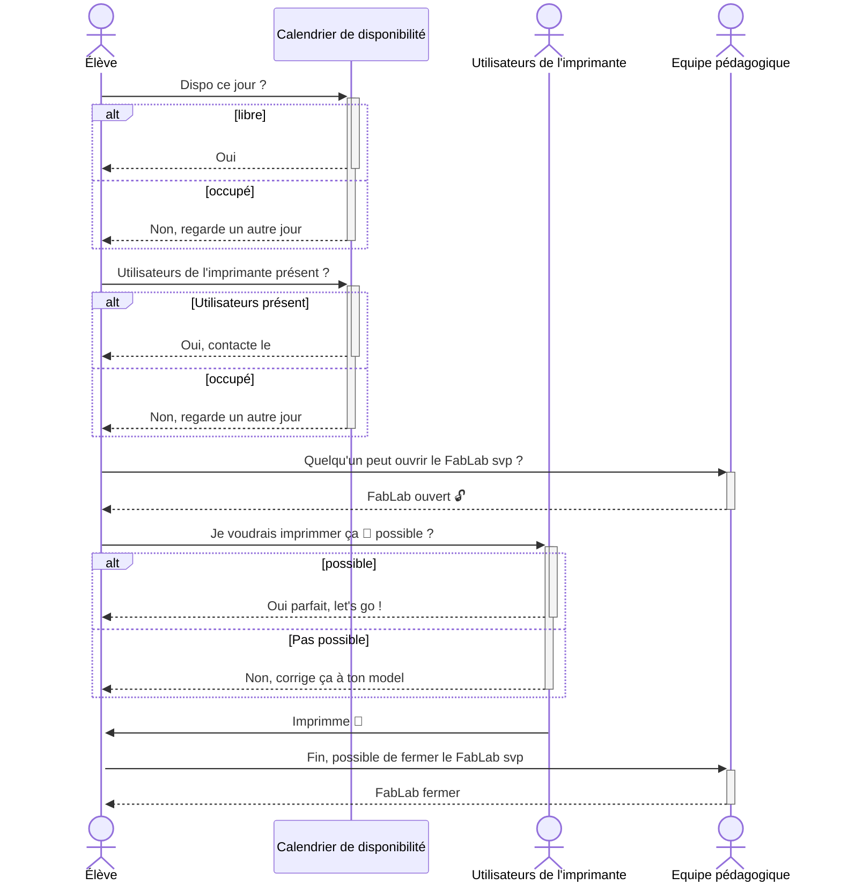
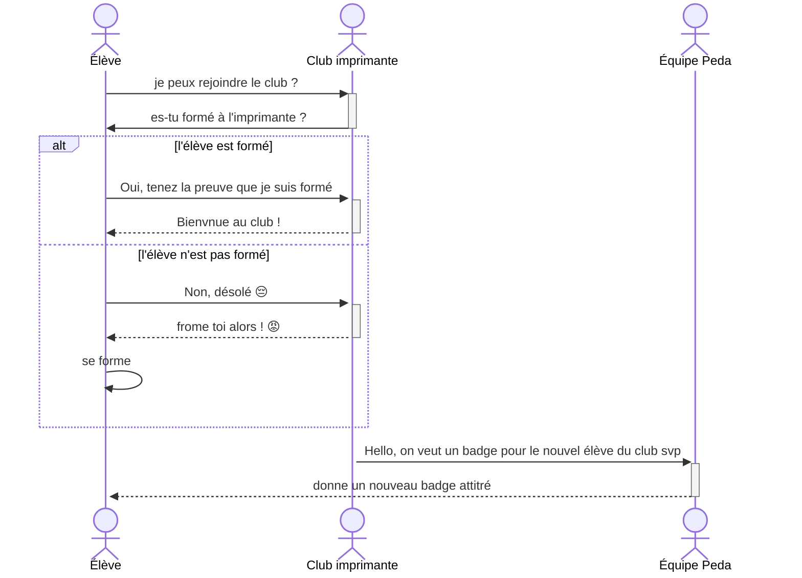
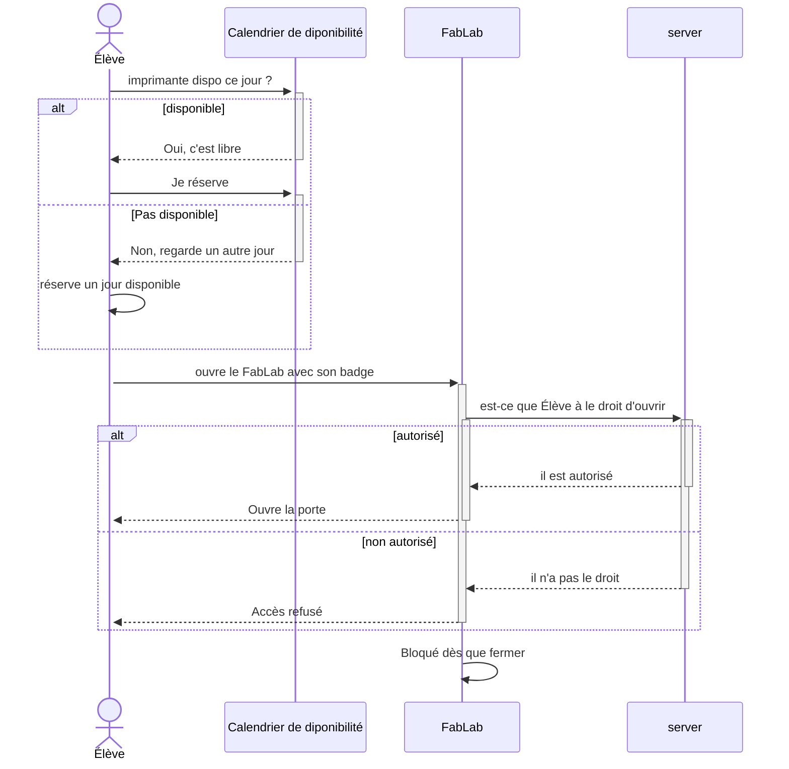

# TP UML Imprimante-3D

## Constat

- nouveau, jamais eu de réservation encore (On ne sait trop encore comment le cas est géré)
- Voir avec Thomas
- Fermer à clé dans le FabLab (avoir quelqu'un pour l'ouvrir)
- filament (soit tu utilises et tu en remets, soit tu ramènes tiens).
- L'imprimante ne bouge pas de l'école (comme un écran ou une multiprise)
- il y en a qu'une suele (comme l'appereil photo)
- ça coûte chère.
- Avoir un minimum de connaissance.
- Imprime quand on est pas là ?
- l'imprimante n'est pas "connectable", on enregistre notre model sur une carte SD qu'on insère dans l'imprimante, puis on sélectionne notre model

### Diagrame de séquence de l'organisation

### Simplification avec un ajout de badge pour le club imprimante

### Une fois que l'élève à un badge

