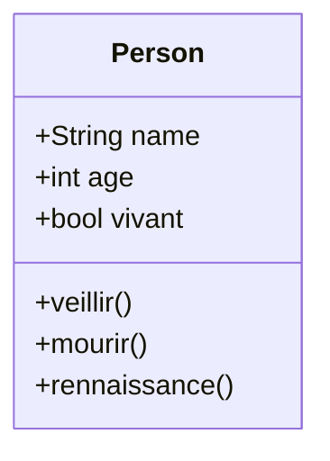
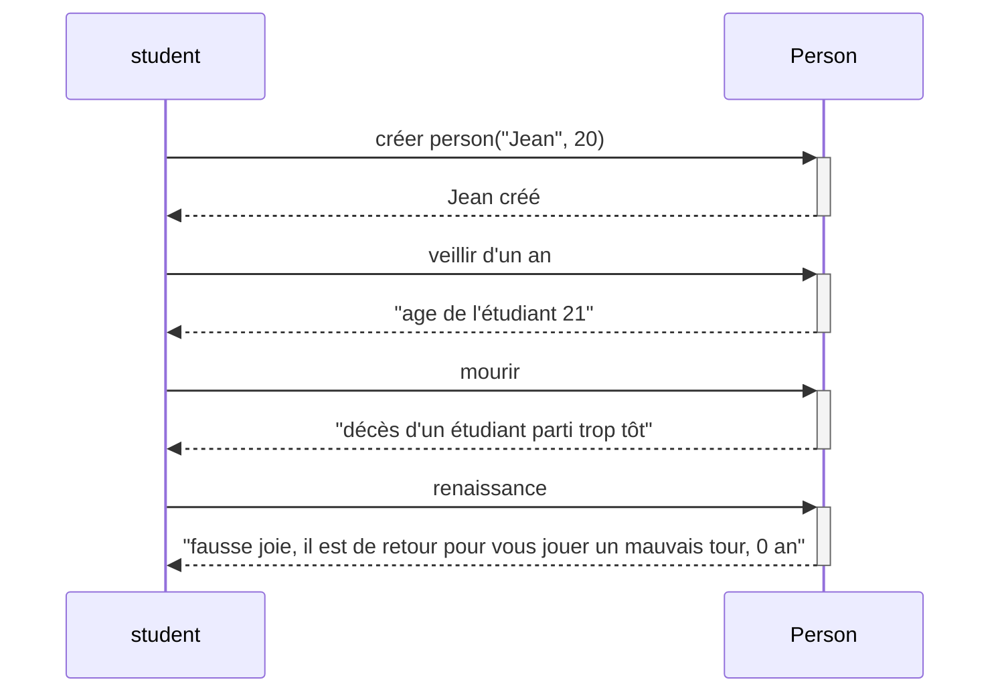
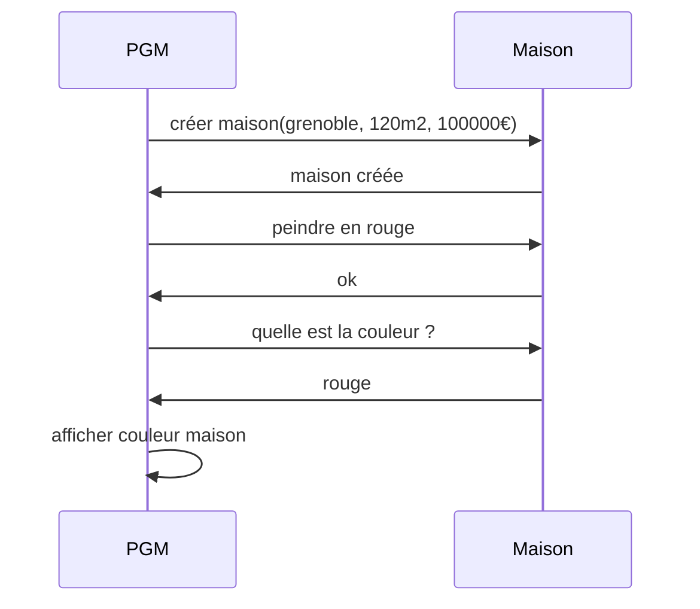
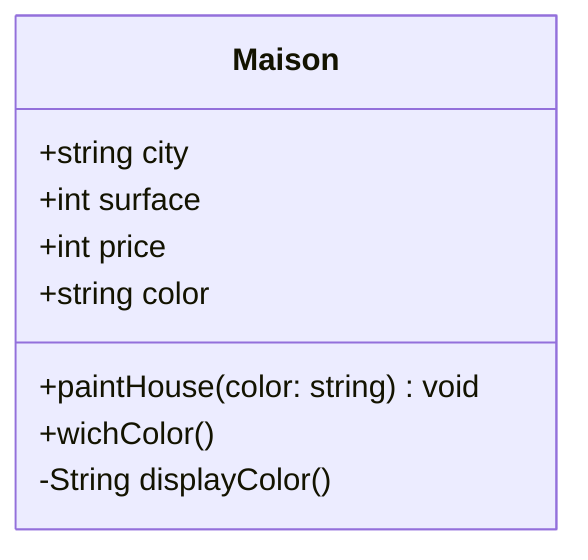

# Devoir - Conception logicielle

## 1 - From code to UML

A partir du code suivant, réaliser :
1. le diagramme de classe avec Mermaid ( / 4)
2. le diagramme de séquence avec Mermaid ( / 8)

```typescript
class Person {
  public name: string;
  public age: number;
  public vivant: boolean = true;

  constructor(name, age) {
    this.name = name;
    this.age = age;
    this.vivant = true;
  }

  veillir() {
    this.age++;
  }

  mourir() {
    this.vivant = false;
    console.log("Mesdames, Messieurs, Aurevoir");
  }

  renaissance() {
    this.age = 0;
    this.vivant = true;
  }
}

const student = new Person("Jean", 20);
student.veillir();
console.log("age de l'étudiant", student.age);
student.mourir();
console.log("décès d'un étudiant parti trop tôt");
student.renaissance()
console.log("fausse joie, il est de retour pour vous jouer un mauvais tour", student.age);
```

### 1.1 Diagramme de classe attendu


### 1.2 Diagramme de séquence attendu



## 2 - From UML to code

A partir du diagramme de séquence suivant, réaliser :
1. le diagramme de classe avec Mermaid ( / 5)
2. le code correspondant ( / 3)


### 2.1 le diagramme de classe avec Mermaid



### 2.2 Le code

```ts
class Maison {
  public city: string;
  public color?: string;
  public surface: number;
  public price: number;

  constructor(city: string, surface: number, price: number) {
    this.city = city;
    this.surface = surface;
    this.price = price;
    }

    paintHouse(color: string){
        this.color = color;
        console.log("ok")
    }

    whichColor(){
        console.log(this.color)
    }

    displayColor(){
        return this.color
    }

}

const maison = new Maison("Grenoble", 120, 100000);
maison.paintHouse("red")
maison.whichColor()
console.log(maison.displayColor())
```