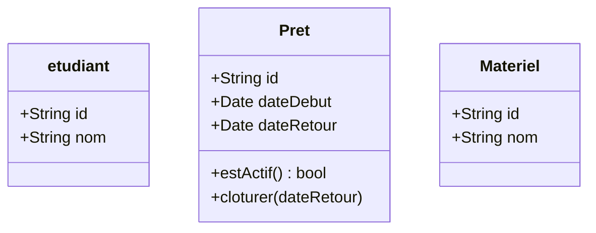

# UML

## note en vrac
- Cours UML youtube Delphine Longuet, vidéo 1, 2, 3 de la playlist UML

## Exercice Début 

### Réservation de materiel
- Lucas peut voir qui a louer quoi
- suivre l'état du stock
- prix
- Multiprise, appareil photo, ordinateur, imprimante 3D, câble HDMI, etc.

#### Réflexion des différents acteurs
- Lucas :
  - Il peut voir qui a loué quoi
  - Il peut suivre l'état du stock
- Les étudiants :
  - Ils peuvent réserver du matériel
- la fiche de suivi du matériel :
  - Elle contient le nom de l'étudiant, le matériel loué, la date de réservation, la date de retour, etc.

#### Qui fait quoi, dans quel ordre ?
- Un étudidant identifé chosit un materiel et demande à l'école de l'emprunter

## Outils

Mermaid live editor : https://mermaid.live/
- Utile pour générer des diagrammes UML à partir de texte. Peut-être fort combiné avec nos connaissances et l'IA

### Classe

### Pour l'évaluation
- un exo : Partir d'une histoire -> Digramme de cas d'utilisation -> Diagramme de séquence -> Diagramme de classes -> Digrame de MCD
- un exo : partir du MCD -> Diagramme de classes -> Diagramme de séquence -> Digramme de cas d'utilisation -> Histoire