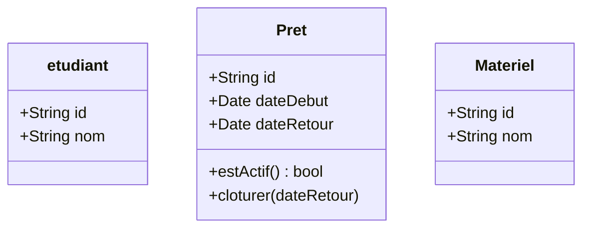
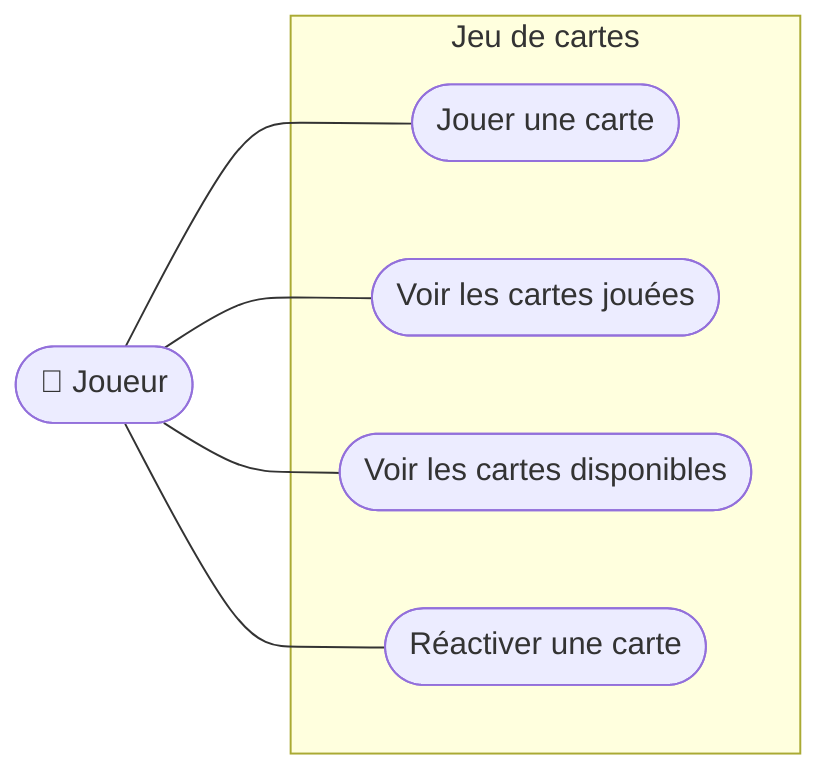
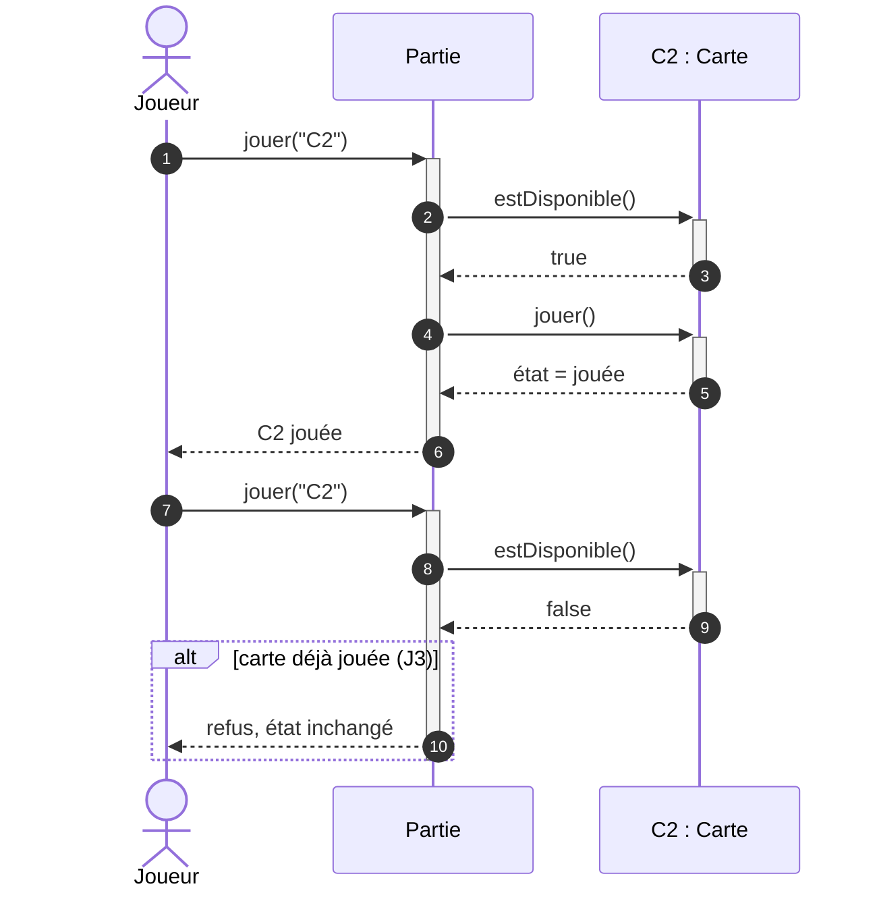
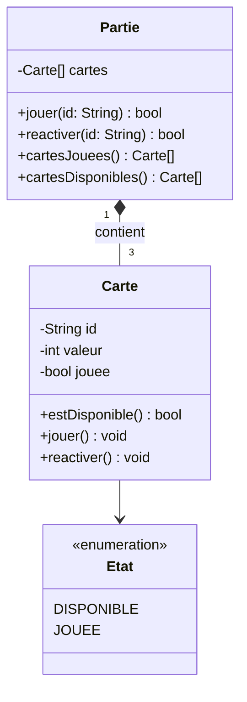
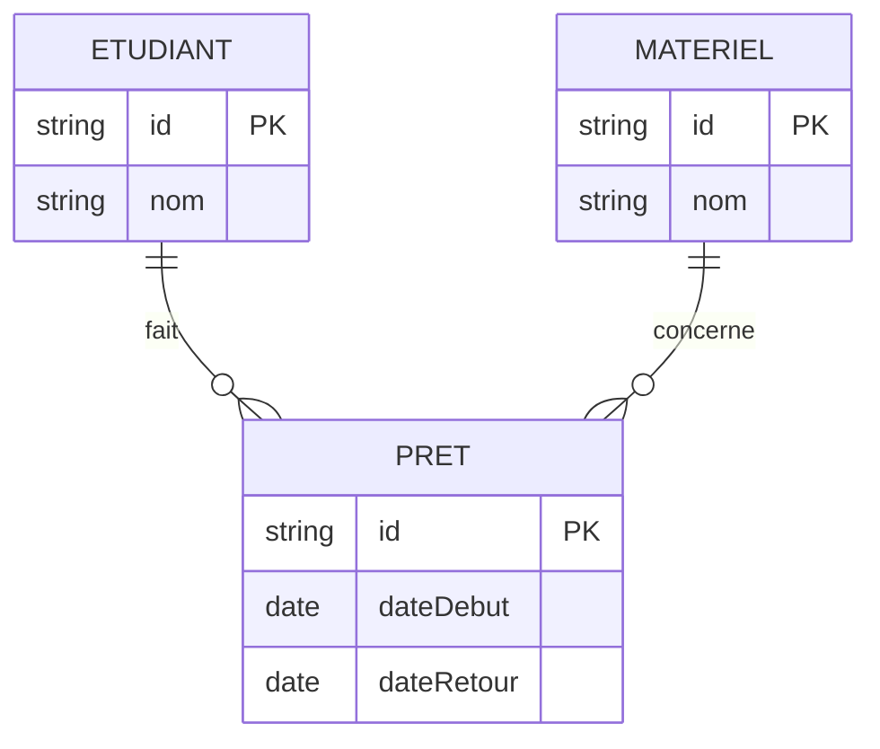

# UML

## note en vrac
- Cours UML youtube Delphine Longuet, vidéo 1, 2, 3 de la playlist UML

## Exercice Début 

### Réservation de materiel
- Lucas peut voir qui a louer quoi
- suivre l'état du stock
- prix
- Multiprise, appareil photo, ordinateur, imprimante 3D, câble HDMI, etc.

#### Réflexion des différents acteurs
- Lucas :
  - Il peut voir qui a loué quoi
  - Il peut suivre l'état du stock
- Les étudiants :
  - Ils peuvent réserver du matériel
- la fiche de suivi du matériel :
  - Elle contient le nom de l'étudiant, le matériel loué, la date de réservation, la date de retour, etc.

#### Qui fait quoi, dans quel ordre ?
- Un étudidant identifé chosit un materiel et demande à l'école de l'emprunter


## Outils

Mermaid live editor : https://mermaid.live/
- Utile pour générer des diagrammes UML à partir de texte. Peut-être fort combiné avec nos connaissances et l'IA

### Classe


### Pour l'évaluation
- un exo : Partir d'une histoire -> Digramme de cas d'utilisation -> Diagramme de séquence -> Diagramme de classes -> Digrame de MCD
- un exo : partir du MCD -> Diagramme de classes -> Diagramme de séquence -> Digramme de cas d'utilisation -> Histoire

---

# Cheat sheet — jour de l'exam

## 0. La démarche (étapes A → D du TP)

| Étape | Question | Livrable |
|---|---|---|
| A | **Qui** utilise le système, pour **quoi faire** ? | Diagramme de cas d'utilisation |
| B | **Comment** ça se passe, pas à pas ? | Scénario nominal + scénario(s) de refus |
| C | **Qui parle à qui**, dans quel ordre ? | Diagramme de séquence |
| D | **Qui sait quoi / qui fait quoi** ? | Diagramme de classes (attributs, opérations, relations) |
| (E) | Qu'est-ce qu'on doit **garder** après fermeture ? | MCD (seulement s'il y a de la persistance) |

Sens inverse (MCD → histoire) : entités = classes, associations = relations, les verbes des associations deviennent des opérations / messages, puis on remonte aux cas d'utilisation et on raconte l'histoire.

**Repérer les éléments dans un texte :**
- Noms communs → classes / entités (Carte, Partie, Matériel, Prêt…)
- Propriétés d'un nom (valeur, date, nom) → attributs
- Verbes d'action → cas d'utilisation, messages, opérations (jouer, réserver, réactiver…)
- Personnes / systèmes extérieurs → acteurs
- Règles (« J2 : jouer une carte disponible la fait passer à l'état joué ») → **pas** des cas d'utilisation : ce sont des conditions qui donnent les branches `alt` du scénario et de la séquence.

---

## 1. Diagramme de cas d'utilisation

**Ce que ça montre :** les fonctionnalités vues de l'extérieur. Pas d'ordre, pas de détail technique.

- **Acteur** : rôle extérieur au système (humain ou autre système). Bonhomme.
- **Cas d'utilisation** : un objectif de l'acteur, formulé **verbe à l'infinitif + complément** (« Jouer une carte », « Réserver un matériel »). Ovale.
- **Frontière du système** : rectangle avec le nom du système, les cas sont dedans, les acteurs dehors.
- **Association** acteur — cas : trait plein.
- `<<include>>` : A inclut **toujours** B (B est obligatoire). Flèche pointillée de A vers B.
- `<<extend>>` : B étend A **parfois**, sous condition. Flèche pointillée de B vers A.
- **Généralisation** entre acteurs : un Admin *est un* Utilisateur (flèche à triangle vide).


> Mermaid n'a pas de vrai diagramme de cas d'utilisation stable : `flowchart` + `subgraph` fait le job (ou `usecase-beta` comme dans le TP2 si la version le supporte).

---

## 2. Scénario (fiche de cas d'utilisation)

```
Cas : Jouer une carte
Acteur : Joueur
Préconditions : une partie est en cours
Scénario nominal :
  1. Le joueur choisit une carte disponible (ex. C2)
  2. Le système passe la carte à l'état « jouée »
  3. Le système affiche les listes à jour
Scénario de refus (alternatif / erreur) :
  1a. La carte est déjà jouée → refus, l'état ne change pas (J3)
Postconditions : C2 est dans la liste des cartes jouées
```

- **Nominal** = le chemin où tout se passe bien.
- **Alternatif / refus** = on part d'une étape du nominal (numérotation `1a`, `2a`…).
- Toujours donner les **résultats attendus** (listes avant/après) quand le sujet le demande.

---

## 3. Diagramme de séquence

**Ce que ça montre :** les échanges de messages entre acteurs/objets, **dans le temps** (de haut en bas).

| Élément | Signification | Mermaid |
|---|---|---|
| Acteur | humain | `actor J as Joueur` |
| Participant | objet / système | `participant P as Partie` |
| Message synchrone | appel, on attend la réponse | `A->>B: jouer(C2)` |
| Retour | réponse (toujours **pointillé**) | `B-->>A: ok` |
| Message asynchrone | on n'attend pas | `A-)B: notifier()` |
| Message à soi-même | appel interne | `A->>A: afficher()` |
| Activation | rectangle « en train de travailler » | `A->>+B` puis `B-->>-A` |
| Création | instanciation (`new`) | `create participant C` puis `A->>C: new` |

**Fragments combinés :**
- `alt` / `else` / `end` : si / sinon (règles métier, refus)
- `opt` / `end` : si sans sinon
- `loop` / `end` : boucle
- `par` / `and` / `end` : en parallèle
- `Note right of A: texte`
- `autonumber` en tête pour numéroter les messages



**Code → séquence :** chaque appel de méthode = un message `objet->>+Classe`, chaque `return` / `console.log` de résultat = un retour pointillé `-->>-`. Le `new` = message de création.

---

## 4. Diagramme de classes

**Ce que ça montre :** la structure statique : classes, attributs, opérations, relations.

**Une classe :**
```
NomClasse
--------------
- attribut : Type
--------------
+ operation(param : Type) : TypeRetour
```

**Visibilité :** `+` public · `-` privé · `#` protégé · `~` package
**Static** : souligné (Mermaid : `$` à la fin) · **Abstrait** : italique (Mermaid : `*` à la fin)

**Relations (de la plus faible à la plus forte) :**

| Relation | Sens | UML | Mermaid |
|---|---|---|---|
| Dépendance | A *utilise* B ponctuellement | flèche pointillée | `A ..> B` |
| Association | A *connaît* B (attribut) | trait plein | `A --> B` ou `A -- B` |
| Agrégation | A *contient* B, B peut vivre seul | losange vide côté A | `A o-- B` |
| Composition | A *possède* B, B meurt avec A | losange plein côté A | `A *-- B` |
| Héritage | B *est un* A | triangle vide vers A | `A <\|-- B` |
| Réalisation | B implémente l'interface A | triangle vide pointillé | `A <\|.. B` |

**Multiplicités (UML, côté de la classe d'arrivée) :** `1` exactement un · `0..1` zéro ou un · `*` ou `0..*` plusieurs · `1..*` au moins un · `3` exactement trois.



**Questions de conception (TP2) :**
- Qui connaît l'ensemble des cartes ? → la **Partie** (elle a la liste).
- Qui connaît l'état d'une carte ? → la **Carte** elle-même.
- Une seule classe qui fait tout ? → non, moins lisible : **chaque classe a une seule responsabilité**, l'info est là où elle est utilisée.

**Code ↔ classe :**

| Code (TS) | UML |
|---|---|
| `class Maison` | classe `Maison` |
| `public city: string` | `+city : String` |
| `private x` | `-x` |
| `color?: string` | `+color : String [0..1]` |
| `paintHouse(color: string)` | `+paintHouse(color: String) : void` |
| `displayColor() { return this.color }` | `+displayColor() : String` |
| `constructor(...)` | souvent omis, ou `+Maison(city, surface, price)` |
| `class B extends A` | `A <\|-- B` |
| `class B implements I` | `I <\|.. B` |
| attribut de type `Carte[]` | association `"1" --> "*"` vers `Carte` |

---

## 5. MCD (Modèle Conceptuel de Données — Merise)

**Ce que ça montre :** les données à **conserver** (base de données). Pas de méthodes.

- **Entité** : objet métier persistant (Étudiant, Matériel). Rectangle.
- **Identifiant** : souligné, unique (`idEtudiant`).
- **Propriétés** : les attributs à stocker.
- **Association** : verbe qui relie des entités (« emprunte »), ovale. Elle peut porter des propriétés (ex. `dateDebut`, `dateRetour` sur « emprunte »).
- **Cardinalités** `(min, max)` : `0,1` · `1,1` · `0,n` · `1,n`

⚠️ **Lecture Merise ≠ UML :** en Merise la cardinalité est écrite **du côté de l'entité dont on parle** (« un Étudiant emprunte 0,n Matériel » → `0,n` près d'Étudiant). En UML la multiplicité est écrite **du côté opposé**.

```
ETUDIANT (0,n) —— EMPRUNTE —— (0,n) MATERIEL
                  dateDebut
                  dateRetour
```


Notation Mermaid (pattes de corbeau) : `||` exactement 1 · `|o` 0 ou 1 · `}|` 1 ou plusieurs · `}o` 0 ou plusieurs.

**MCD → classes :** entité → classe, propriétés → attributs, association `(0,n)-(0,n)` avec propriétés → classe d'association (ex. `Pret`), association `(1,1)-(0,n)` → association `1 --> *`.

**Quand faire un MCD ?** Uniquement si des données doivent **survivre à la fermeture de l'application**.
- TP2 : la partie reste en mémoire, fermer efface tout → **pas de MCD**, le diagramme de classes suffit.
- Extension « retrouver ses parties le lendemain » : il faut conserver `PARTIE (idPartie, date)` et `CARTE (idCarte, valeur, etat)`, avec `PARTIE (1,n) — CONTIENT — (1,1) CARTE`.

---

## 6. Pièges à éviter

- Cas d'utilisation = **objectif de l'acteur** (verbe), pas une règle métier ni une étape technique.
- Retours de message en **pointillé** (`-->>`), appels en **plein** (`->>`).
- Équilibrer `+` / `-` des activations sinon Mermaid plante.
- Dans une séquence, les participants sont des **objets** (`c2 : Carte`), pas juste des classes.
- Visibilité du diagramme de classes **cohérente avec le code** (une méthode `public` dans le code n'est pas `-` dans le diagramme).
- Mettre le **type de retour** des opérations (`displayColor() String`).
- Même orthographe partout : le nom d'une opération dans la séquence = le nom dans le diagramme de classes = le nom dans le code.
- Composition (`*--`) seulement si la partie ne peut pas exister sans le tout.
- Pas de clés étrangères ni de méthodes dans un MCD.
- Ne pas confondre cardinalités Merise et multiplicités UML (côtés inversés).
